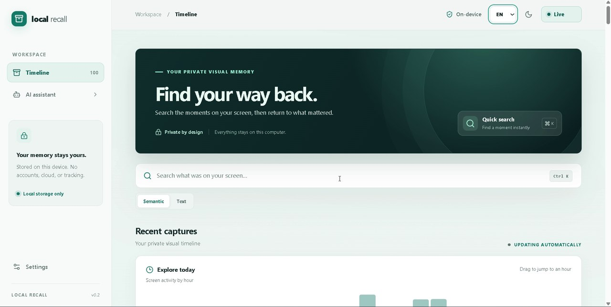

# 🚀 Local Recall

*The 100% private, offline-first open-source alternative to Windows Recall.*

   

[Star Local Recall on GitHub](https://github.com/goodmir100/local-recall)

Local Recall turns your screen history into a searchable, private timeline. Screenshots, OCR, search, and the optional AI assistant run on your own Windows PC. The app has no cloud account, sync service, or telemetry endpoint. It masks detected sensitive text before a screenshot is written to disk.

## See it in action

[](assets/local-recall-demo.mp4)

[▶ Watch the 62-second demo](assets/local-recall-demo.mp4) · H.264 MP4, 5.5 MB

> **Offline after setup:** Installing Python and npm packages and downloading AI models requires an internet connection once. Normal capture, search, and chat use local services and files.

## Features

- 🔒 **100% offline & private:** Captures and the SQLite database stay in `%APPDATA%\LocalRecall` by default.
- 🤖 **On-device AI assistant:** Ask questions about your screen history through a local Ollama model. Try `gemma2:2b`, `llama3`, or `qwen2.5`.
- 🛡️ **Smart PII auto-redaction:** OCR and pattern matching cover card-number patterns, API keys, passwords, and bearer tokens. Matching screen regions are masked **before saving**. Detection is best effort; review captures before sharing them.
- ⚡ **Spotlight quick search (`Ctrl + K` / `Alt + Space`):** Search recognized text and semantic matches with thumbnail previews. These shortcuts work while the Local Recall browser tab is focused.
- 🎯 **Interactive bounding boxes:** Click recognized text on a captured screen to copy it.
- ⏳ **Visual time-travel slider:** Explore an hourly activity heatmap and scrub through today's captures.
- 🌐 **Multilingual & multitheme:** English and Russian interface text, with dark and light modes.
- 💻 **Hardware agnostic:** Runs on standard Windows 10/11 PCs without an NPU. AI speed depends on your CPU, RAM, and chosen model.

## Local Recall and Windows Recall

| Feature | Windows Recall | **Local Recall** |
| :--- | :--- | :--- |
| **Privacy & cloud** | Processes and stores snapshots locally; Windows diagnostic settings may apply | **Local storage and processing; no app telemetry** |
| **Hardware requirements** | Copilot+ PC with an NPU | **Windows 10/11 PC; no NPU required** |
| **Sensitive information** | Can filter out snapshots containing detected sensitive information | **Masks matching OCR regions before saving a capture** |
| **AI model** | Built-in Windows experience | **Choose an installed Ollama model** |
| **Source code** | Proprietary | **Open source (MIT)** |

Microsoft's [Recall privacy documentation](https://support.microsoft.com/en-us/windows/privacy/privacy-and-control-over-your-recall-experience) describes its local storage and sensitive-information filtering. Its [device requirements](https://learn.microsoft.com/en-us/windows/client-management/manage-recall) include a Copilot+ PC and NPU.

## Architecture and tech stack

```text
Screen capture (mss) → RapidOCR → PII masking → JPEG + SQLite/FTS5
                                     ↓
                     multilingual embeddings → hybrid search
                                     ↓
                      FastAPI ← Vue UI → local Ollama
```

- **Backend:** Python 3.12+, FastAPI, multilingual RapidOCR, `sentence-transformers/paraphrase-multilingual-MiniLM-L12-v2`, SQLite with FTS5, pystray, and mss.
- **Frontend:** Vue 3, TypeScript, Tailwind CSS, Pinia, and built-in English/Russian dictionaries.
- **AI engine:** The local Ollama HTTP API. Ollama is optional for capture, timeline, and text search.

## Quick start

### Windows launcher

1. Install **Python 3.12+** and **Node.js 20+** and make sure both are on `PATH`. Install [Ollama](https://ollama.com/) only if you want AI chat.
2. Clone the repository and enter it:

   ```bat
   git clone https://github.com/goodmir100/local-recall.git
   cd local-recall
   ```

3. Run `run_app.bat`. It creates a backend virtual environment, installs dependencies, downloads the embedding model if missing, and opens separate backend and frontend terminal windows.
4. Open [http://localhost:5173](http://localhost:5173). The API is at [http://127.0.0.1:8765/docs](http://127.0.0.1:8765/docs).

The launcher caches the embedding model during first-time setup. The app loads it from the local cache and never downloads it during capture.

For AI chat, install a model while online, for example `ollama pull gemma2:2b`. Start Ollama if it is not already running. The model picker also accepts other models installed in Ollama, including `llama3` and `qwen2.5`.

### Manual setup

Run these commands in **Command Prompt** from the repository root. Keep each service running in its own window.

**Backend**

```bat
cd backend
python -m venv venv
venv\Scripts\python.exe -m pip install -r requirements.txt
venv\Scripts\python.exe -c "from sentence_transformers import SentenceTransformer; SentenceTransformer('sentence-transformers/paraphrase-multilingual-MiniLM-L12-v2')"
venv\Scripts\python.exe -m uvicorn app.main:app --host 127.0.0.1 --port 8765
```

**Frontend** (new Command Prompt window)

```bat
cd frontend
npm ci
npm run dev
```

Open [http://localhost:5173](http://localhost:5173). To build the frontend, run `npm run build` in `frontend`.

### Data and privacy

- Screenshots: `%APPDATA%\LocalRecall\screenshots`
- Database: `%APPDATA%\LocalRecall\recall.db`
- The API and Vite development server bind to the local machine. The Ollama URL is restricted to a local HTTP address.
- Redaction recognizes patterns, so it cannot guarantee that every secret or personal detail is hidden. Exclude sensitive apps in Settings and inspect captures before exporting or sharing them.

## Contributing and license

Issues and pull requests are welcome. Run the backend tests from `backend` with `venv\Scripts\python.exe -m unittest discover -s tests`, and run `npm run build` from `frontend` before submitting a change.

Released under the [MIT License](LICENSE).
